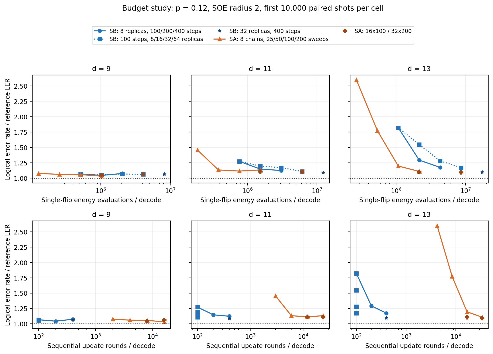
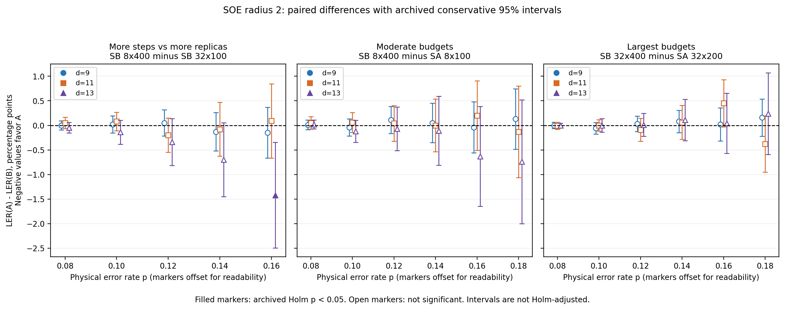

# 新增预算证据图与解读

本目录使用归档汇总数据绘制，未运行新解码实验。原论文与原图均保留。生成脚本为 `analysis/plot_evidence_budget.py`；从项目目录运行 `python analysis/plot_evidence_budget.py` 可复现。输入 SHA256 和比较统计保存在 `manifest.json`，实际绘图数据保存在两个 CSV 中。每幅图提供 PDF、SVG、PNG。

## 1. 准确率—总工作量／串行轮数

[PDF](resources_p0.12.pdf) · [SVG](resources_p0.12.svg)

左右三列分别为 d=9、11、13，上排横轴是每次解码单生成元翻转能量差的评估总数，下排是串行更新轮数，横轴均为对数刻度。纵轴是 LER/REF（线性刻度），越低越好，水平点线为参照 1。全部采用 SOE r=2，各格均使用预算研究的前 10,000 个配对 shot。纵轴是错误率比值点估计，不是成功率；本图没有从边际区间推造比值区间。

蓝实线圆点固定 8 个 SB 副本、增加步数；蓝点线方块固定 100 步、增加副本；蓝星是 SB 32×400。橙实线三角固定 8 条 SA 链、增加 sweep；棕色加号是 SA 16×100 和 32×200。下排增加副本不会改变定义的串行轮数，因此方块在相同横坐标上排列，不用折线连接。

**支持的结论：** 在大码、相同能量评估总量的配置比较中，增加扫描长度可比增加副本更有效；d=13 的 8×400 与 32×100 都约为 430 万次评估，前者在 p=.12 的 r2 比值约 1.17，后者约 1.28。小码的收益弱得多，不能把这条规律写成所有格点都单调改善。下排显示 SB 具有更短的串行依赖链，上排同时显示其达到相近准确率可能付出更多总评估。

工作量定义为 SB 的 8RSm 和 SA 的 8CWm，串行轮数为 S 和 Wm。这里假设类、启动和副本/链可并行执行，SB 同步变量更新；它没有计入有限硬件的线程数、访存、归约、同步代价，也不是实际延迟。能量评估数只度量搜索中的指定操作，不是完整程序的 FLOP、能耗或端到端成本。不同生成元支撑、矢量化和软件实现也会影响实际耗时。

全部六个物理错误率均提供，避免只展示有利切片：[p=.08](resources_p0.08.pdf)、[p=.10](resources_p0.10.pdf)、[p=.12](resources_p0.12.pdf)、[p=.14](resources_p0.14.pdf)、[p=.16](resources_p0.16.pdf)、[p=.18](resources_p0.18.pdf)。p=.18 只有原研究实际运行的五种配置，不补插值；图例中的参数扫描说明完整配置系列，缺失点未绘制。p=.08 的 d=13 参照在该子集仅失败 16 次，比值较不稳定。主文建议选 .12 与 .16，其余放补充材料，并说明选择是代表切片。

## 2. 配对改善与置信区间

[PDF](paired_improvements_r2.pdf) · [SVG](paired_improvements_r2.svg)

三个面板分别比较：SB 8×400 对 SB 32×100（相同能量评估总量）；SB 8×400 对 SA 8×100；SB 32×400 对 SA 32×200。三组均使用 SOE r=2。横轴为物理错误率，码距用蓝圆点、橙方块、紫三角表示。为防重叠，标记在实际 p 附近作微小水平错开。纵轴为 100×[LER(A)−LER(B)]，单位是百分点；负值表示面板标题中前一个配置更好，零线表示无差异。

区间直接来自 `budget_paired_matched.csv`。源码 `code/qec_sb/p5/statistics.py` 的 `exact_paired_statistics` 对配对胜、负比例分别构造 Clopper–Pearson 区间，通过 Bonferroni 分配错误率后相减，得到保守的至少 95% 覆盖差值区间；不是 bootstrap 或常规独立样本误差棒。实心标记代表归档 Holm p<.05，空心表示未显著。Holm 原比较族按 family 与 a 分组，保留全部原格点；没有仅对图中显示的点重新校正。区间未做跨格点 Holm 调整，其过零与实心标记不应被当作同一种检验。

| 比较 | 格点数 | A 的 LER 较低格点 | Holm 显著格点 | 合并 A 对/B 错 vs A 错/B 对 |
| --- | ---: | ---: | ---: | ---: |
| SB 8×400 − SB 32×100 | 15 | 9 | 1 | 1935 vs 1643 |
| SB 8×400 − SA 8×100 | 18 | 8 | 0 | 3169 vs 3048 |
| SB 32×400 − SA 32×200 | 18 | 4 | 0 | 1134 vs 1200 |

左图的 d=13 高 p 点向负侧移动，支持延长扫描在这一困难区域比增加副本更有用；只有一个格点经 Holm 校正显著，所以不应写成“逐格一致显著改善”。合并计数只是跨异质格点的描述，不替代逐格结论。

中、右图显示指定预算的 SB/SA 差异较小且所有格点均未通过原 Holm 显著性标准。可以表述“在这些样本和检验下未检出显著差异，点估计显示接近的准确率水平”，不能表述“证明两算法等价”或“达到相同最优解”。未做预设等价界的等价检验。

## 3. 在新论文中怎样使用

资源图适合回答“什么资源应随规模增加、SB 的同步结构带来什么取舍”；配对图为这个问题提供效应大小及不确定性。它们补足原时间图受实现因素影响、原比值图不展示配对不确定性的不足。

这两类新图来自预算研究，不是新独立留出测试；不能据此提高原研究的验证强度。它们也没有单独识别 SOE 的误差上限或证明全局搜索收敛；此类主张仍须结合 MAP/r1/r2 消融及更直接证据。原有论文、正式图目录及实验 CSV 未被改写。

## 4. 验证记录

生成时检查了预算数据键的唯一性、工作量表唯一性、多对一连接无缺失、10,000-shot 样本量、总能量评估公式，以及每条绘制配对差与胜负计数一致。已视觉检查 p=.12 的资源图和配对图，标题、图例、区间和单位均可读。其他 p 图使用同一生成模板；输入指纹可由 manifest 核对。
