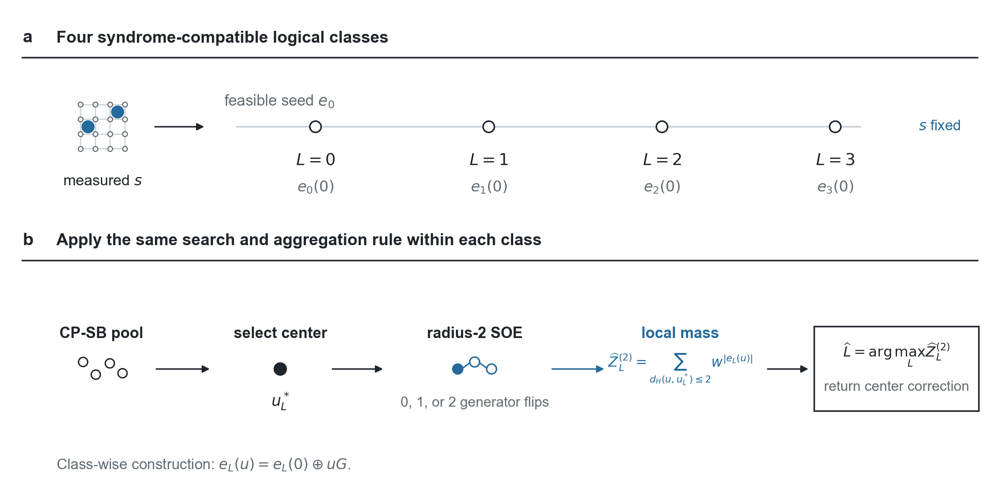

# SECTION_II 正式中文译文

对应已批准26项语言润色后的[正式英文稿](MANUSCRIPT.md)。引用、图表与公式编号保持一致。

## II. 方法：解码器构造

图1概括了解码流程。我们在每个与综合征相容的逻辑类中搜索低权重中心，累加该中心周围完整邻域的概率权重，再选择局部质量最大的类。该求和包括搜索未访问的等价错误。

II A–C 节定义目标、可行能量和搜索；II D–E 节定义聚合及其精确半径二计算；II F 节定义匹配的模拟退火对照。

**图1：保持约束的搜索与局部简并性聚合。** (a) 测得的综合征 s 与可行种子 e₀ 定义四个与该综合征相容的逻辑类种子 e_L(0)，其中 L=0,1,2,3。稳定子生成元翻转同时保持综合征和逻辑类。(b) 对每个类分别应用相同流程：保持约束的模拟分岔（CP-SB）给出终态候选，初始种子也保留在候选池中。池内 Pauli 权重最低的候选定义中心 u_L*。稳定子轨道展开（SOE）在满足 d_H(u,u_L*)≤2 的完整生成元坐标球内累加 w^{|e_L(u)|}，其中 w=p/[3(1−p)]，得到局部质量 Ẑ_L^(2)。解码器选择局部质量最大的类，并返回其中心错误作为纠正操作。该求和在指定球内精确，但不覆盖完整逻辑类。示意邻域表示生成元翻转，而非码上的物理距离。

### A. 解码目标与逻辑类

为了比较逻辑类概率，我们首先需要规定每个类中的错误及其统计权重。

考虑码距为 \(d\)、含 \(n=d^2\) 个数据量子比特和 \(m=n-1\) 个独立稳定子生成元的旋转平面表面码，噪声为独立退极化噪声。每个量子比特发生 \(X\)、\(Y\) 或 \(Z\) 的概率分别为 \(p/3\)。对于二元辛表示错误向量 \(e\in\mathbb F_2^{2n}\)，令 \(|e|\) 表示非恒等 Pauli 因子的数量。其概率为

\[
P(e)=(1-p)^n w^{|e|},\qquad w=\frac{p}{3(1-p)}.
\tag{1}
\]

该码编码一个逻辑量子比特，因此有四个逻辑 Pauli 类。采用 \(e=(e^x,e^z)\) 的约定；单量子比特上的 \(Y\) 表示为 \((1,1)\)，但在 \(|e|\) 中只贡献一个单位。测得的综合征记为 \(s\)。

选择与综合征相容的种子 \(e_0\)。令 \(G\) 以独立稳定子生成元为行，\(\ell_L\) 为四个逻辑 Pauli 类的代表，\(L=0,1,2,3\)。这里 \(G\in\mathbb F_2^{m\times2n}\)，式(2)的所有乘法与加法均在 \(\mathbb F_2\) 上进行，\(\ell_L\) 为零综合征逻辑算符。类 \(L\) 中的每个错误都有唯一表示

\[
e_L(u)=e_0\oplus\ell_L\oplus uG,\qquad u\in\mathbb F_2^m.
\tag{2}
\]

未归一化类概率为

\[
Z_L(s)=\sum_u w^{|e_L(u)|}
=\sum_u e^{-\beta E_L(u)},\quad
E_L(u)=|e_L(u)|,\quad \beta=\log\frac{3(1-p)}p.
\tag{3}
\]

条件类概率为 \(Z_L/\sum_{L'}Z_{L'}\)。最大似然解码选择最大的 \(Z_L\)，在所研究噪声范围内等价于选择最小的有效自由能 \(-\beta^{-1}\log Z_L\)。这里 \(\beta\) 是由噪声模型决定的统计参数，而非物理器件温度。

候选 MAP 比较每个类中找到的最低能量。没有精确搜索时，该规则不一定给出最小权重解码。我们以选定候选为中心，估计预设局部质量。

### B. 精确约束与 Pauli 权重能量

我们用稳定子坐标保证约束，用物理 Pauli 权重定义搜索能量。

种子通过分别匹配 \(X\) 和 \(Z\) 分量得到。二元线性系统的解也能提供可行种子，但种子质量会影响有限预算搜索。式(2)保证每个二元配置同时保持综合征和逻辑类。

令生成元自旋为 \(\sigma_j=(-1)^{u_j}\)，定义

\[
\tau_q^x=(-1)^{(e_0\oplus\ell_L)_q^x}
\prod_{j:G_{j,q}=1}\sigma_j,
\qquad
\tau_q^z=(-1)^{(e_0\oplus\ell_L)_q^z}
\prod_{j:G_{j,n+q}=1}\sigma_j.
\]

精确的非恒等指示函数为

\[
\mathbf1[e_q\ne I]
=\frac34-\frac14\tau_q^x-\frac14\tau_q^z
-\frac14\tau_q^x\tau_q^z.
\tag{4}
\]

对式(4)求和得到 Pauli 权重 Hamiltonian。在该表面码中，每个量子比特至多接触每种类型的两个生成元，因此多线性表示的项至多为四阶，无需综合征罚项或辅助自旋。SB 演化连续变量，其符号则指定可行物理错误。以 \(E_L(\sigma)\) 表示多线性自旋形式，在 \(\sigma_j=(-1)^{u_j}\) 时与 \(E_L(u)\) 一致。

### C. 保持约束的 SB 候选搜索

现在，我们用 SB 在这个可行能量景观中搜索候选中心。动力学生成供聚合使用的候选；最终类判决还取决于候选周围的邻域。

对单个副本，\(x,y\in\mathbb R^m\) 分别表示位置和动量。设 \(\operatorname{sgn}(0)=+1\)，通过 \(u_j=(1-\operatorname{sgn}x_j)/2\) 恢复生成元比特。对每个类和重启，CP-SB 演化 \(R\) 个副本，共 \(S\) 步：

\[
y\leftarrow y+\Delta t[-(1-a_k)x+c f(\operatorname{sgn}x)],
\qquad x\leftarrow x+\Delta t\,y,
\qquad a_k=(k+1)/S.
\tag{5}
\]

步索引为 \(k=0,\ldots,S-1\)：动量更新使用当前位置，位置更新使用刚更新的动量。每次更新后，将超出 \([-1,1]\) 的坐标设为相应边界符号，并将其动量重置为零。初始动量为零。作用力是在符号顶点处计算的多线性能量负梯度：

\[
f_j(\sigma)=\frac{\sigma_j}{2}
\left[E_L(\sigma^{(j)})-E_L(\sigma)\right],
\tag{6}
\]

其中 \(\sigma^{(j)}\) 翻转自旋 \(j\)。此恒等式允许直接通过物理生成元翻转计算，无需引入二次替代目标。耦合为 \(c=\kappa/\max(1,\max_j B_j)\)，其中 \(B_j\) 是含 \(j\) 的能量单项式系数绝对值之和。

我们先合并相同单项式，再计算该系数界。

每个类使用一次热启动重启，初始位置为 \(0.08+\mathcal N(0,0.01^2)\)，以及一次随机重启，位置均匀分布于 \((-0.1,0.1)\)。每次重启含 \(R\) 个副本。末态符号配置与初始二元种子 \(u=0\) 组成候选池。删除重复比特串后按能量排序，能量相同时按比特串字典序破同值。首个候选成为聚合中心。轨迹中间状态不加入该池。因此，预算记号 \(R\times S\) 对应四个类和两种重启模式下的 \(8R\) 条轨迹。固定搜索配置为 \(R=8\)、\(S=100\)、\(\Delta t=0.45\)、\(\kappa=0.70\)。

### D. 完整局部邻域聚合

每个选定中心只代表一个错误配置。为了比较各类，我们累加该中心周围预设稳定子等价邻居集合的概率权重。

聚合集合是生成元坐标中的完整预设 Hamming 球，包括搜索未访问的配置。半径衡量生成元翻转数，而非物理错误权重或空间尺度。对选定中心 \(u_L^*\)，定义

\[
\widehat Z_L^{(r)}=
\sum_{d_H(u,u_L^*)\le r} w^{E_L(u)},
\qquad \widehat L=\arg\max_L\widehat Z_L^{(r)}.
\tag{7}
\]

解码器返回 \(e_0\oplus\ell_{\widehat L}\oplus u_{\widehat L}^*G\) 作为纠正操作。若多个计算评分在相对容差 \(10^{-15}\) 内等于最大值（绝对容差为零），实现选择最小类索引。生成元行独立确保每一项代表不同的物理错误。因此式(7)是指定球上的精确和，也是完整未归一化类质量的下界。它不是精确类概率，也不是获胜类的证明。固定中心时增加半径会增加各类质量，但不保证更准确的类排序。

半径一与半径二的球分别含 \(1+m\) 和 \(1+m+\binom m2\) 个配置。当 \(d=13\) 时，每类分别为 169 和 14,197 个。

### E. 半径二局部概率质量的精确求值

显式半径二求和成本较高，因为生成元对的数量按二次增长。我们结合不相交支撑的可加贡献与重叠对校正，更高效地计算同一个局部和。

令 \(\Delta_j\) 为翻转生成元 \(j\) 的能量变化。对于物理支撑不相交的生成元，

\[
\Delta_{jk}=\Delta_j+\Delta_k.
\tag{8}
\]

首先用单翻转直方图的卷积统计对和，去掉自配对，并将有序对计数除以二。随后，用每个重叠对的真实能量变化替换其可加贡献。令 \(N_t\) 统计能量变化为 \(t\) 的全部半径二配置，包括中心、单翻转和校正后的对。得到的局部质量为

\[
\widehat Z_L^{(2)}=\sum_t N_t w^{E_L(u_L^*)+t}.
\]

实现构造整数计数，检查非负性以及总数 \(1+m+\binom m2\)，再按 Pauli 权重升序累加相应概率。计数恒等式在数学上精确计算预设局部和；实现中的浮点幂与求和会引入舍入。逻辑类中被省略的部分仍不在该和之内。附录 A 推导完整计数恒等式。

生成元支撑和重叠度有界时，在物理中心与支撑结构已知的条件下，局部计数阶段成本为 \(O(m)\)。这一复杂度只针对局部和。归档实现还通过稠密矩阵运算重构物理候选，并建立缓存的重叠结构；完整预处理与候选选择流程不受该线性界覆盖。

### F. 匹配设置的模拟退火对照

为了隔离搜索动力学的作用，我们以模拟退火替换 SB，保留可行表示与聚合规则。该对照使用相同的局部概率估计器比较两种搜索过程。

CP-SA 对照共享可行种子、类 Hamiltonian、候选池构造和聚合规则。它采用单生成元 Metropolis 提议，在 \(W\) 次扫描中按几何温度表从 2.0 降至 0.05，每种重启模式含 \(C\) 条链，预算记为 \(C\times W\)。热启动链从 \(u=0\) 开始，随机链从独立均匀二元状态开始。每次扫描在每条链中按新的随机排列访问全部 \(m\) 个生成元。能量不增加的提议直接接受；\(\Delta E>0\) 的提议以概率 \(e^{-\Delta E/T}\) 接受。当 \(W\ge2\) 时温度表包含两个端点；单次扫描使用初始温度。该搜索温度不同于式(3)的信道参数 \(\beta\)。虽然 SA 求解器也记录历史最优状态，但基准预测池仅使用末态与种子，去重和破同值规则与 SB 相同。每次扫描包含每条链内 \(m\) 次串行提议，其工作量不等同于一个 SB 步。固定推断半径，可在不改变概率估计器的前提下比较两种搜索过程。
