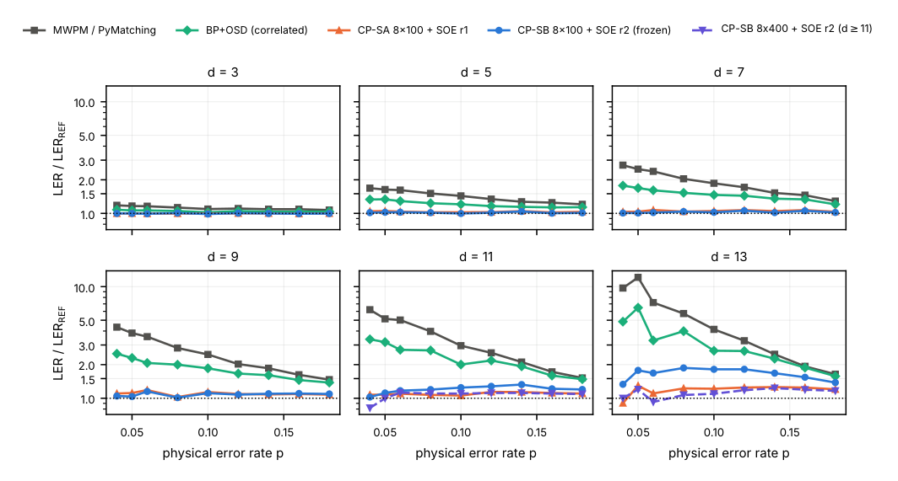
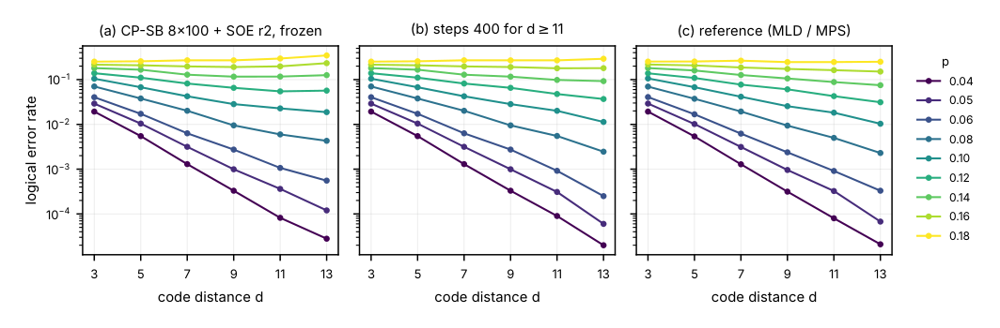
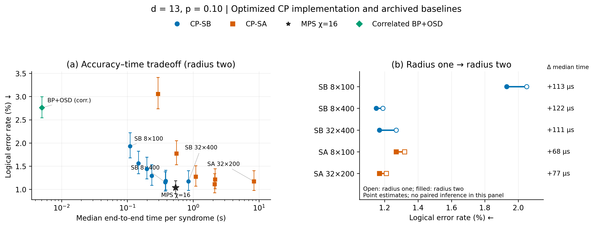
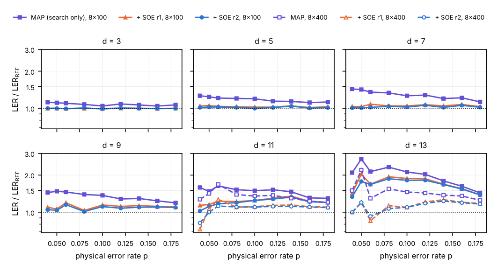

# SECTION_IV 正式中文译文

对应 2026-10-31 批准合并的[压缩英文初稿](MANUSCRIPT.md)。引用、图表与公式编号保持一致。

## IV. 结果

我们首先报告留出准确率，再考察预算分配、固定候选下的聚合以及计算成本。图2–5给出主要比较；补充图 S1–S2 保留资源比较与配对效应。

### A. 固定配置解码器的准确率

我们从留出测试前固定的配置开始评估。基线衡量其实际改进，REF 则用于识别剩余准确率差距。主解码器在全部 54 个留出条件中均优于匹配和相关 BP+OSD，且各条件在 Holm 校正后均显著（最大校正 p 值分别为 8.7×10⁻¹² 和 0.0077）。对匹配的汇总不一致胜/负计数为 55,081/17,007，对相关 BP+OSD 为 41,739/21,099。

码距不超过九时，LER 至多为 REF 的 1.1513 倍；这 36 个条件中，27 个在 III C 节的 Holm 比较族下未显示显著配对差异，但这不建立等效性。在码距 11 和 13 时，最大比值分别增至约 1.33 和 1.87，揭示了固定参数下较大码的差距。

**图2：相对REF的准确率。** 每个面板对应一个码距；横轴为物理错误概率，纵轴为LER/REF。水平参照线对应比值一。主方法实线采用固定配置解码器。d=11和13处的紫色倒三角扩大预算曲线属于探索性结果，使用各自评估子集，其中低噪声条件仅有100,000 shots。比值是点估计，不表示已提供配对比值区间。在低噪声和较大码距下，参照的失败数较少，因此这些比值对抽样尤其敏感。CP-SA曲线使用半径一，而主CP-SB曲线使用半径二；它们的差距不能单独隔离搜索动力学的作用。

### B. 有限尺寸行为与搜索预算分配

较大码距下的差距提出两个问题：更多搜索是否改善准确率，以及应如何分配搜索投入。将 SB 步数从 100 增至 400，使码距 11、13 的全部 18 个扩大预算条件的 LER 点估计降低，其中 12 个在 Holm 校正后显著。当 p≥0.08 时，码距 11 的 REF 比值由 1.20–1.33 变为 1.09–1.12，码距 13 则由 1.38–1.87 变为 1.07–1.23。这些改善为所选预算规则提供探索性证据，而非独立确认。

CP-SB 8×400 与 32×100 使用相同翻转能量评估数（码距 13 时为 4,300,800），但不一定具有相同运行时间或端到端工作量。在码距 13、p=0.12 的 10,000-shot 子集上，两者半径二 REF 比值约为 1.17 和 1.28。跨 15 个条件，较长运行在不一致 shots 上胜/负为 1,935/1,643；其 LER 在九个条件更低，但仅一个差异在 Holm 校正后显著。这不建立普遍的预算分配优势。

码距 11/13 的交叉由约 p=0.1167 移至 0.1581，REF 则为 0.1765。估计分别在 p 区间 0.10–0.12、0.14–0.16、0.16–0.18 内对对数 LER 差进行线性插值，未给出交叉位置置信区间。这体现预算敏感性，而非渐近阈值：尺寸有限，且较大预算是在查看扫描后选择的。

**图3：固定与扩大搜索预算下的有限尺寸行为。** 物理错误概率区分各条曲线；横轴为码距，纵轴为逻辑错误率。面板分别比较固定配置解码器、在d=11和13采用400步的解码器，以及REF。曲线次序变化说明有限预算敏感性，而非确立了渐近阈值。所报告交叉是d=11和13的LER作为物理错误概率的函数时相等的位置，不是此码距横轴图中彩色曲线之间的交叉。

**图4：码距13、p=0.10下的准确率与端到端时间。** (a) 所有归档SB、SA预算的半径二聚合结果，与固定键维数MPS（χ=16）及相关BP+OSD比较。竖直误差棒为逐点Wilson 95%区间：每个CP配置10000个准确率样本，每个基线20000个。对数时间轴展示100个不同非平凡综合征上的中位数。CP计时包含种子生成、搜索与聚合，但不含每个码的一次性准备。我们采用优化CP计时和归档基线计时，并结合已有准确率观测；本轮未重新运行准确率实验。(b) 所选配置：空心、实心标记分别为半径一、二的LER点估计。标签给出两个端到端时间中位数之差，不是逐综合征时间差的中位数。该面板不提供配对显著性检验或计时置信区间。SB标签为副本数×步数，SA标签为链数×扫描次数。

图4展示依赖具体实现的准确率—时间取舍。SB 8×400耗时0.375秒，固定χ=16 MPS为0.540秒，前者少约30.5%；对应LER点估计为1.15%和1.035%。这不建立准确率等效，也不证明全面优于MPS。五个所选配置的半径二聚合均降低LER点估计，端到端时间中位数之差约为68–122微秒；这些微小计时差异没有不确定性估计。算法资源与配对预算比较仍见补充图S1–S2。

### C. 搜索后局部聚合带来什么

改变搜索预算会改变候选。下面固定候选池，以隔离推断规则的作用。在固定候选池下，用局部聚合替代候选 MAP 可改善准确率，无需假定搜索达到全局最优。在码距 13、p=0.12 的 10,000-shot 子集上，CP-SB 32×400 的 MAP、半径一和半径二 REF 比值分别为 1.382、1.115、1.096；CP-SA 32×200 分别为 1.376、1.099、1.093。这些示例的预算大于图5中的固定搜索和 8×400 搜索。

半径二在 54 个网格条件中的 50 个进一步降低 LER，其中三个在校正后显著，汇总胜/负为 5,222/4,337。半径在生成该网格前已选定，因此这些比较描述其后续表现。

**图5：candidate-MAP与局部聚合。** 六面板图比较candidate-MAP、SOE半径一和半径二相对REF的比值，横轴为物理错误概率。实线采用固定预算搜索；在有数据时，虚线空心标记采用扩大预算。固定搜索下的比较隔离推断规则的变化。竖直差距表示解码性能变化，不是误差来源的可加因果分解。特别是，若不独立控制搜索质量，不能将半径二残差全部归因于截断。

在扫描的最大 SB 和 SA 预算下，码距 13、p≥0.10 的半径二 REF 比值仍约为 1.075–1.129。补充图 S2 右面板没有条件通过 Holm 校正。相近的剩余差距促使我们进一步研究估计器。这既不建立判决等价，也不证明搜索收敛，更强搜索仍可能有帮助。

### D. 工作量、串行轮数与实际耗时

下面比较达到这些准确率所需的资源，将算法计数与实现相关的实耗时间分开讨论。在码距 13 时，SB 8×400 的评估数为 SA 8×100 的四倍，但轮数为 400 而非 16,800；SB 32×400 的评估数为 SA 32×200 的两倍，但轮数为 400 而非 33,600。两个半径二比较在各自 18 条件的 Holm 比较族内均无显著差异（补充图 S1–S2）。因此，工作量与深度的取舍是用二至四倍评估数换取仅为 1/42–1/84 的轮数，并非一个全面占优的搜索器。

**表2：d=13处选定的归档CPU计时。** 单位为每个不同非平凡综合征的秒数中位数，在p=0.10测量。每行标明计时阶段；仅搜索时间不是端到端解码时间。CP搜索与端到端行使用优化后的稀疏搜索/直方图实现；显式SOE行是在优化计时批次中重测的历史算法，两行SOE均指定SB 8×100配置。基线行保留归档实现，执行环境的限制见III D节。

| 配置或阶段 | 时间（秒） |
|---|---:|
| PyMatching解码器 | 0.000043 |
| 相关BP+OSD解码器 | 0.0050 |
| MPS，χ=16 | 0.540 |
| MPS，χ=32 | 3.269 |
| SB搜索，8×100 | 0.104 |
| SB搜索，8×400 | 0.369 |
| SB搜索，32×400 | 0.841 |
| SA搜索，8×100 | 1.084 |
| SA搜索，32×200 | 8.33 |
| 显式半径二SOE，SB 8×100（历史） | 3.540 |
| 直方图半径二SOE，SB 8×100（优化） | 0.000816 |
| 端到端：SB 8×100 + 半径二 | 0.110 |
| 端到端：SB 8×400 + 半径二 | 0.375 |

分阶段计时展示了快速局部计数在多大程度上降低聚合成本。对码距 13 的 SB 8×100 候选池，直方图聚合将半径二计算在同一优化计时批次中由 3.53979 s 减至 0.00081604 s，约加速 4,300 倍；这是阶段加速，而非整个解码器的加速。对CP-SB 8×100、码距至少11的CP-SB 8×400及CP-SA 8×100，在相同的 42,800 次解码上检查半径一、二，发现稀疏搜索与全向量搜索的候选池相同，判决（包括破同值）不变，类评分最大相对差为 1.2×10⁻¹⁵。这些有限检查不覆盖图4的所有预算，不保证评分逐比特相同，也不提供新准确率数据。

图4的固定χ比较没有测量完整定向验证REF流程的运行时间。SB/SA 的 CPU 比值也混合了批处理、语言开销和算法结构。硬件延迟需要测量内存流量、同步与占用率；仅减少更新轮数不能证明加速。
