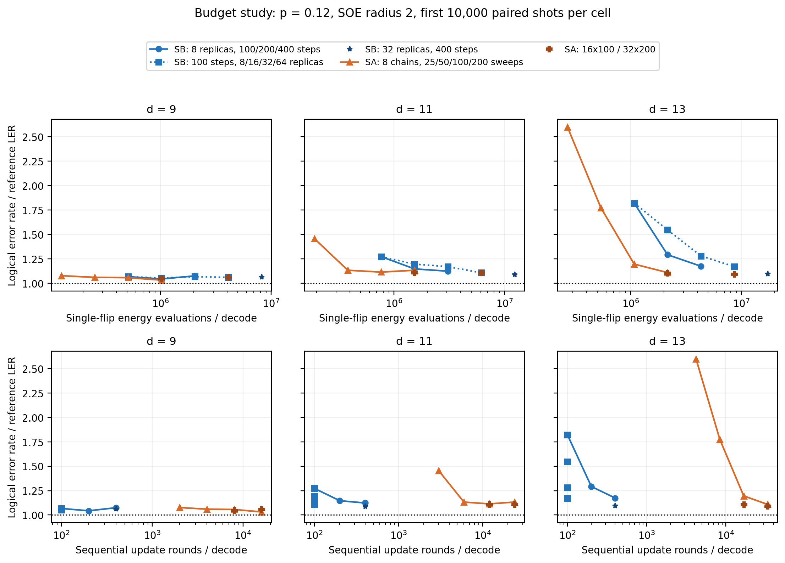
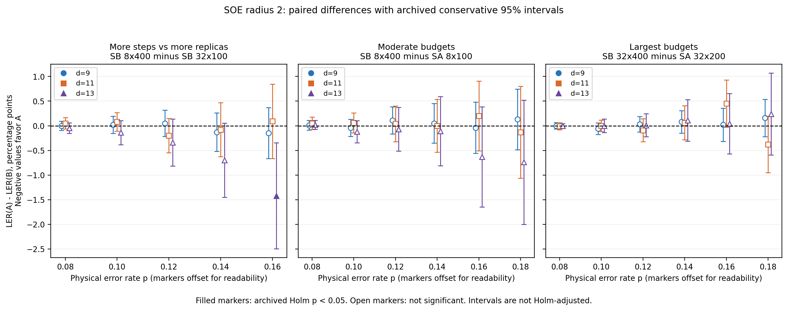

# 随稿补充材料：资源、计时与配对效应证据

本材料补充正文中的码容量结果。各图复用第 III A 节所述样本，因此不构成独立评估。项目内来源索引见 [ARCHIVE_DATA_INDEX.md](ARCHIVE_DATA_INDEX.md)；公开归档标识与访问链接须在正式投稿前补充。

## S1. 准确率与搜索资源

**图 S1：在 \(p=0.12\) 时，准确率与两种搜索资源的关系。** 三列分别对应 \(d=9,11,13\)。上排绘制 LER/REF 随总翻转能量评估次数的变化；下排以串行更新轮数为横轴。横轴均为对数坐标。每个点使用 SOE 半径二，同一测试条件内使用相同的 10,000 个样本。蓝色圆点表示在八个副本下增加 SB 步数；蓝色方块表示在 100 步下增加副本数；蓝色星形表示 \(32\times400\)。橙色三角形表示在八条链下增加 SA 扫描次数，其他 SA 预算另用标记表示。上下两排采用同一组准确率点估计。补充图 S2 给出所选比较的配对不确定性。横坐标按照式（10）计算搜索工作量和串行轮数，并非实测运行时间或完整端到端成本。在固定 SB 步数下改变副本数，串行轮数保持不变。其他噪声切片列于随稿补充材料；\(p=0.18\) 切片仅包含在该噪声率实际评估过的配置。

实测时间见正文图4中的优化CP准确率—时间比较；上述资源计数不涵盖完整端到端成本。

## S2. 配对效应量

**图 S2：预算比较中的配对效应量。** 横轴为物理错误概率；标记的少量水平偏移仅用于显示。纵坐标为 \(100[\mathrm{LER}(A)-\mathrm{LER}(B)]\)，单位是百分点；负值有利于各面板首先列出的配置。三个面板依次比较 SB \(8\times400\) 与 SB \(32\times100\)、SB \(8\times400\) 与 SA \(8\times100\)，以及 SB \(32\times400\) 与 SA \(32\times200\)。所有配置均使用半径二。颜色和标记形状表示码距。误差棒是各测试条件的保守 95% 区间，由对两类不一致结果概率采用 Bonferroni 分配的 Clopper–Pearson 区间相减得到；它们不是经过 Holm 调整的跨条件同时置信区间。实心点表示精确配对检验的归档 Holm 校正值小于 0.05，所用比较族见第 III C 节；检验未针对显示的子集重新计算。区间与校正检验是不同的统计程序；未检出显著性并不建立等效性。左面板覆盖 \(p=0.08\)–0.16 的 15 个条件，其他面板覆盖 \(p=0.08\)–0.18 的 18 个条件。在 \(p=0.18\) 时没有评估 SB \(32\times100\)。

图中的区间与 Holm 校正检验回答不同的统计问题。无显著差异或区间重叠均不建立等效性。

## S3. 其他资源切片

以下五页依次给出其他资源图：[p=0.08](../analysis_outputs/evidence_budget/resources_p0.08.pdf)、[0.10](../analysis_outputs/evidence_budget/resources_p0.10.pdf)、[0.14](../analysis_outputs/evidence_budget/resources_p0.14.pdf)、[0.16](../analysis_outputs/evidence_budget/resources_p0.16.pdf) 和 [0.18](../analysis_outputs/evidence_budget/resources_p0.18.pdf)。这些图沿用补充图 S1 的资源定义；p=0.18 仅包含实际评估过的配置。这些切片提供同一组观测的更多视图。
