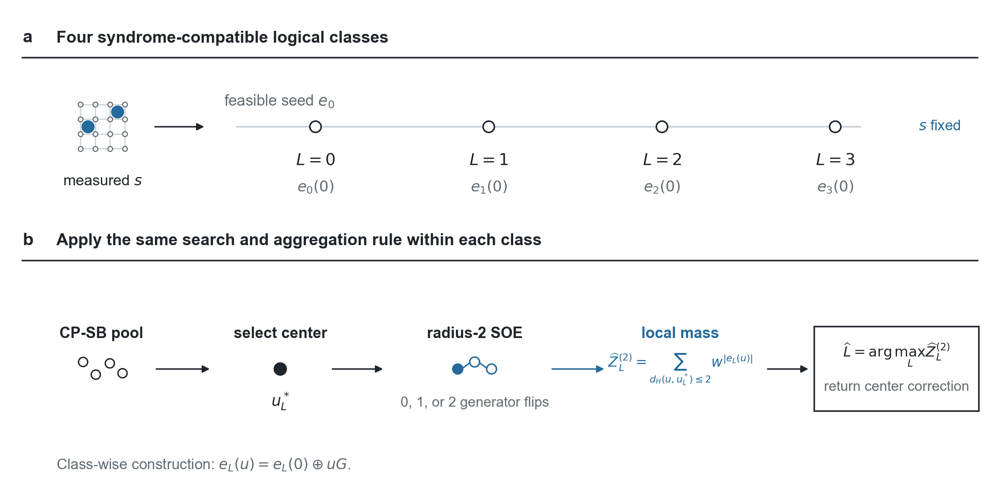
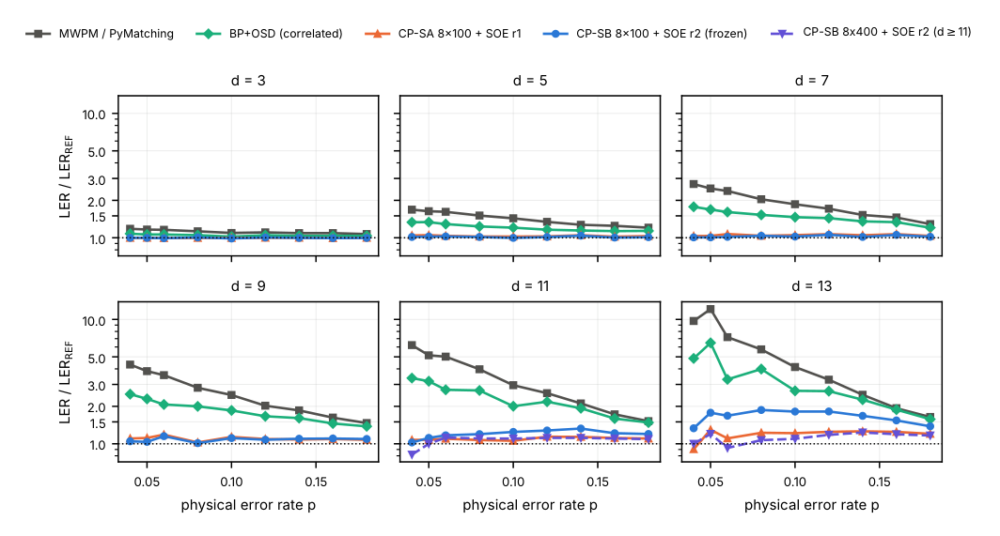
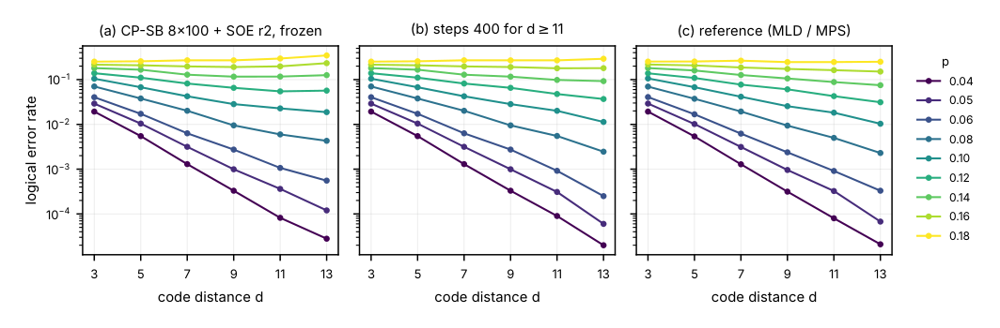
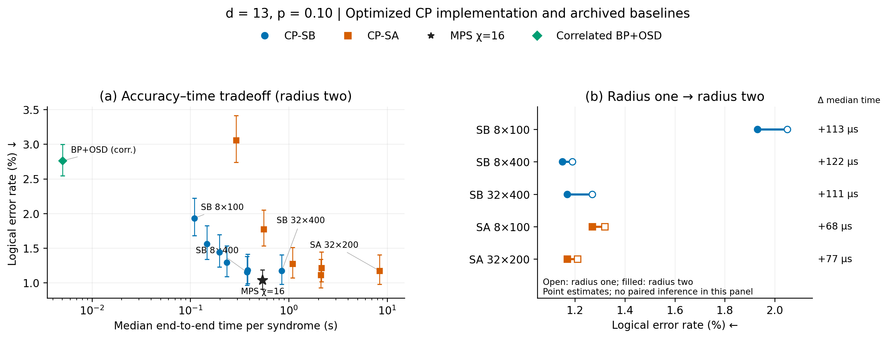
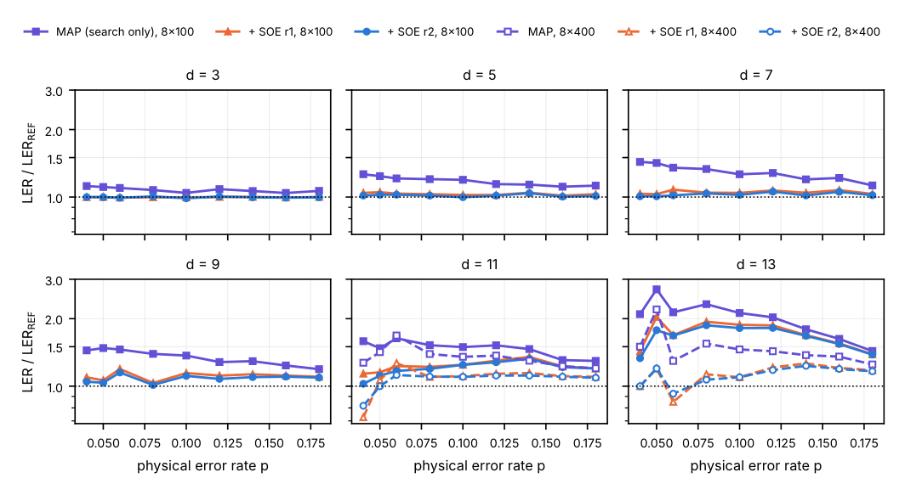

# Quantum-Inspired Search Meets Quantum Error Decoding: Constraint-Preserving Simulated Bifurcation with Local Degeneracy Aggregation

**Jiapei Zhuang¹ and Yaocheng Chen²,\***

¹ Quantum Science Center of Guangdong-Hong Kong-Macao Greater Bay Area, Shenzhen 518045, China

² Instituto de Astronomia, Geofísica e Ciências Atmosféricas (IAG-USP), Universidade de São Paulo, Rua do Matão 1226, São Paulo, SP 05508-090, Brazil

\* Corresponding author: <yaochengchen@usp.br>

## Abstract

Quantum error decoding can be formulated as Ising optimization, but selecting the most probable error configuration does not generally identify the logical class with the largest total probability. We combine quantum-inspired search with local degeneracy aggregation to estimate logical-class probabilities. Constraint-preserving simulated bifurcation (SB) searches within each logical class in stabilizer-generator coordinates to find a low-energy candidate. An energy-change histogram with overlap corrections gives the exact probability mass of the complete radius-two neighborhood around each candidate. This local mass remains a truncated approximation to the full logical-class mass. On rotated surface codes under code-capacity depolarizing noise, the decoder with fixed search parameters and an independently selected aggregation radius outperforms matching and the tested correlated belief-propagation with ordered-statistics post-processing baseline in all 54 held-out conditions. For distances up to nine, its logical error rate is at most 1.1513 times the exact or matrix-product-state reference. Exploratory increases in search effort improve larger-distance accuracy, while aggregation improves candidate-MAP inference at fixed candidate pools. Selected distance-13 SB and simulated-annealing configurations have similar error rates, with SB using two to four times more flip-energy evaluations but 42–84 times fewer sequential update rounds under the defined parallel-update model. These results show how quantum-inspired search and local probability aggregation can improve quantum error decoding beyond candidate selection alone. In the tested SB–SA comparisons, this approach trades greater total work for fewer sequential update rounds.

## I. Introduction

Quantum error correction is a key ingredient of fault-tolerant quantum computation, protecting logical information from physical noise through redundant encoding and error recovery [1]. Recent experiments demonstrate surface-code memories below threshold and elements of integrated fault-tolerant architectures [2,3]. The classical decoder that interprets error syndromes also determines how well these memories protect logical information, as decoding improvements on experimental surface-code data illustrate [4]. Scaling quantum error correction therefore requires accurate decoders with manageable computational cost.

Quantum degeneracy requires a decoder to compare classes of errors, rather than individual errors. Errors differing by a stabilizer act identically on encoded information; maximum-likelihood decoding therefore selects the logical class with the largest total probability [5]. In an Ising formulation, even a globally minimum-energy error can belong to a less probable class. The challenge is to connect low-energy search to logical-class inference.

Several approaches address different parts of this problem. Minimum-weight perfect matching efficiently decodes suitable error graphs [6], while belief propagation with ordered-statistics post-processing handles more general parity-check structures [7]. Tensor-network methods approximate class probabilities by contraction [8,9]; Markov-chain Monte Carlo, population annealing, and worm methods estimate probabilities or ratios through sampling [10,11,12]. These methods address two related tasks: finding favorable error configurations and estimating the total weight of their logical classes.

Ising formulations connect quantum decoding to physics-inspired optimization. Digital Annealer decoders use quadratic unconstrained binary optimization and have been extended to circuit-level noise [13,14]. Stabilizer-generator coordinates instead satisfy syndrome constraints exactly, as demonstrated for surface and color codes [15,16]. Iterative low-order decoding alternates between subproblems to approximate cross-type correlations and reduce interaction order [17]. These approaches establish an optimization interface, while leaving the choice of search dynamics and the treatment of logical-class probabilities as distinct design questions.

The quantum inspiration for simulated bifurcation (SB) comes from dynamical approaches to optimization. Quantum annealing varies a Hamiltonian to seek low-energy configurations [18]; quantum bifurcation machines use the adiabatic evolution of Kerr-nonlinear parametric oscillators [19]. SB replaces quantum-state evolution with classical position and momentum updates derived from the corresponding nonlinear dynamics [20], an example of physics-inspired computing on classical hardware. Synchronous SB updates support GPU [20,21,22] and FPGA [23,24,25] implementations, with favorable speed–quality tradeoffs on selected Ising benchmarks [21,22]. Extensions include heating and bifurcation control [26,27], higher-order objectives [28], and discrete-phase and Potts variables [29,30]. These developments extend the search dynamics and the variables they can handle; estimating logical-class probabilities remains a separate task.

Combining search with class-probability estimation is also an active direction. Truncated-free-energy decoding reuses stochastic search candidates [31], while probabilistic formulations target class partition functions [32]. We instead sum a complete prescribed generator-space neighborhood around one candidate per class, including configurations absent from the search output. At radius two, we use locality to count these configurations with a histogram, avoiding explicit pair enumeration.

We combine constraint-preserving SB (CP-SB) with local stabilizer-orbit expansion (SOE) and benchmark the resulting decoder on the rotated surface code against an exact or tensor-network reference. Building on the established stabilizer-coordinate representation, our contributions are as follows:

- **Complete local-neighborhood aggregation.** Constraint-preserving SB (CP-SB) supplies class-specific candidates, and stabilizer-orbit expansion (SOE) sums a complete prescribed generator-space Hamming ball around each selected center, including unvisited configurations.
- **Exact radius-two counting.** An energy-change histogram and overlap corrections evaluate the local sum exactly. Counting takes linear work under bounded support and overlap degree once the center and support structure are available; this is not exact full-class inference.
- **Controlled accuracy–resource comparisons.** Held-out testing and paired exploratory budget studies separate search and aggregation effects. At matched inference, the tested SB/SA comparisons identify settings with no significant accuracy difference but greater SB work and fewer sequential rounds. We report implementation-specific timings separately.

The remainder of this paper is organized as follows. Section II constructs the decoder; Sec. III specifies evaluation and resource measures; Sec. IV reports accuracy, aggregation effects, and costs. Sections V and VI discuss limitations and conclude. Appendix A gives the mathematical identities and locality conditions. Supplemental Material contains resource, paired-effect, and extended resource views.

## II. METHODS: Decoder construction

Figure 1 summarizes the decoding procedure. We search each syndrome-compatible logical class for a low-weight center, sum the probability weights over a complete neighborhood around that center, and choose the class with the largest local mass. This sum includes equivalent errors that the search did not visit.

Sections II A–C define the objective, feasible energy, and search; Secs. II D–E define aggregation and its exact radius-two evaluation. Section II F defines the matched simulated-annealing control.

**Figure 1. Constraint-preserving search and local degeneracy aggregation.** (a) A measured syndrome $s$ and a feasible seed $e_0$ define four syndrome-compatible logical-class seeds $e_L(0)$, $L=0,1,2,3$. Stabilizer-generator flips preserve both the syndrome and the logical class. (b) The same procedure is applied independently to each class: constraint-preserving simulated bifurcation (CP-SB) supplies terminal candidates, and the initial seed is also retained in the candidate pool. The lowest Pauli-weight candidate in that pool defines the center $u_L^*$. Stabilizer-orbit expansion (SOE) sums $w^{|e_L(u)|}$, with $w=p/[3(1-p)]$, over the complete generator-coordinate ball $d_H(u,u_L^*)\leq2$, giving the local mass $\widehat Z_L^{(2)}$. The decoder selects the class with the largest local mass and returns its center error as the correction. The sum is exact over this ball, not over the full logical class. The schematic neighborhood denotes generator flips, not physical distance on the code.

### A. Decoding objective and logical classes

To compare logical-class probabilities, we first need to specify the errors in each class and their statistical weights.

We consider independent depolarizing noise on a rotated planar surface code with distance $d$, $n=d^2$ data qubits, and $m=n-1$ independent stabilizer generators. Each qubit experiences $X$, $Y$, or $Z$ with probability $p/3$. For a binary symplectic error vector $e\in\mathbb F_2^{2n}$, let $|e|$ count its nonidentity Pauli factors. Its probability is

$$
P(e)=(1-p)^n w^{|e|},\qquad w=\frac{p}{3(1-p)}.
\tag{1}
$$

The code encodes one logical qubit, giving four logical Pauli classes. We use the convention $e=(e^x,e^z)$, with $Y$ represented by $(1,1)$ at a qubit but contributing only one unit to $|e|$. The measured syndrome is denoted by $s$.

Choose a syndrome-compatible seed $e_0$. Let $G$ contain the independent stabilizer generators as rows, and let $\ell_L$ denote representatives of the four logical Pauli classes, $L=0,1,2,3$. Here $G\in\mathbb F_2^{m\times2n}$, all products and sums in Eq. (2) are over $\mathbb F_2$, and the representatives $\ell_L$ are zero-syndrome logical operators. Every error in class $L$ has a unique representation

$$
e_L(u)=e_0\oplus\ell_L\oplus uG,\qquad u\in\mathbb F_2^m.
\tag{2}
$$

The unnormalized class probability is

$$
Z_L(s)=\sum_u w^{|e_L(u)|}
=\sum_u e^{-\beta E_L(u)},\quad
E_L(u)=|e_L(u)|,\quad \beta=\log\frac{3(1-p)}p.
\tag{3}
$$

The conditional class probability is $Z_L/\sum_{L'}Z_{L'}$. Maximum-likelihood decoding chooses the largest $Z_L$, equivalently the smallest effective free energy $-\beta^{-1}\log Z_L$ in the noise range studied. Here $\beta$ is a statistical parameter fixed by the noise model, not a physical device temperature.

Candidate-MAP compares the lowest energies found in each class. Without exact search, this rule need not give minimum-weight decoding. We use the selected candidates as centers for prescribed local mass estimates.

### B. Exact constraints and the Pauli-weight energy

We use stabilizer coordinates to enforce the constraints and physical Pauli weight to define the search energy.

The seed is obtained by matching the $X$ and $Z$ components separately. A binary linear-system solution would also provide a feasible seed, although its quality can affect a finite-budget search. Equation (2) guarantees that each binary configuration preserves both syndrome and logical class.

With generator spins $\sigma_j=(-1)^{u_j}$, define

$$
\tau_q^x=(-1)^{(e_0\oplus\ell_L)_q^x}
\prod_{j:G_{j,q}=1}\sigma_j,
\qquad
\tau_q^z=(-1)^{(e_0\oplus\ell_L)_q^z}
\prod_{j:G_{j,n+q}=1}\sigma_j.
$$

The exact nonidentity indicator is

$$
\mathbf1[e_q\ne I]
=\frac34-\frac14\tau_q^x-\frac14\tau_q^z
-\frac14\tau_q^x\tau_q^z.
\tag{4}
$$

Summing Eq. (4) gives the Pauli-weight Hamiltonian. On this surface code each qubit touches at most two generators of each type, so the multilinear representation contains terms of order at most four. No syndrome penalty or auxiliary spin is required. SB evolves continuous variables, while their signs specify feasible physical errors. We use $E_L(\sigma)$ for the multilinear spin representation, which agrees with $E_L(u)$ at $\sigma_j=(-1)^{u_j}$.

### C. Constraint-preserving SB candidate search

We now use SB to search this feasible energy landscape for candidate centers. The dynamics generates candidates for aggregation; the final class decision also depends on their neighborhoods.

For one replica, $x,y\in\mathbb R^m$ denote positions and momenta. We set $\operatorname{sgn}(0)=+1$ and recover generator bits through $u_j=(1-\operatorname{sgn}x_j)/2$. For each class and restart, CP-SB evolves $R$ replicas for $S$ steps:

$$
y\leftarrow y+\Delta t[-(1-a_k)x+c f(\operatorname{sgn}x)],
\qquad x\leftarrow x+\Delta t\,y,
\qquad a_k=(k+1)/S.
\tag{5}
$$

The step index is $k=0,\ldots,S-1$: the momentum update uses the current positions, and the position update uses the newly updated momenta. After each update, a coordinate outside $[-1,1]$ is set to its boundary sign and its momentum is reset to zero. The initial momenta vanish. The force is the negative gradient of the multilinear energy evaluated at a sign vertex:

$$
f_j(\sigma)=\frac{\sigma_j}{2}
\left[E_L(\sigma^{(j)})-E_L(\sigma)\right],
\tag{6}
$$

where $\sigma^{(j)}$ flips spin $j$. This identity permits evaluation from physical generator flips without introducing a quadratic surrogate. The coupling is $c=\kappa/\max(1,\max_j B_j)$, where $B_j$ is the sum of absolute coefficients of energy monomials containing $j$.

We combine identical monomials before evaluating this coefficient bound.

Each class receives a warm restart with initial positions $0.08+\mathcal N(0,0.01^2)$ and a random restart with positions uniform in $(-0.1,0.1)$. Each restart has $R$ replicas. Terminal sign configurations and the initial binary seed $u=0$ form the candidate pool. Duplicate bitstrings are removed and the pool is sorted by energy, with lexicographic bitstring order breaking energy ties. The first candidate becomes the aggregation center. Intermediate trajectory states are not added to this pool. Our budget notation $R\times S$ therefore corresponds to $8R$ trajectories across four classes and two restart modes. The fixed search configuration is $R=8$, $S=100$, $\Delta t=0.45$, and $\kappa=0.70$.

### D. Complete local-neighborhood aggregation

Each selected center represents only one error configuration. To compare classes, we add the probability weights of a prescribed set of stabilizer-equivalent neighbors around that center.

The aggregation set is a complete, prescribed Hamming ball in generator coordinates, including configurations that the search did not visit. Its radius measures generator flips, not physical-error weight or spatial extent. For the selected center $u_L^*$, define

$$
\widehat Z_L^{(r)}=
\sum_{d_H(u,u_L^*)\le r} w^{E_L(u)},
\qquad \widehat L=\arg\max_L\widehat Z_L^{(r)}.
\tag{7}
$$

The decoder returns $e_0\oplus\ell_{\widehat L}\oplus u_{\widehat L}^*G$ as a correction. If several computed scores agree with the maximum within relative tolerance $10^{-15}$ (zero absolute tolerance), the implementation chooses the lowest class index. Independent generator rows ensure that every term represents a distinct physical error. Thus Eq. (7) is an exact sum over the specified ball and a lower bound on the full unnormalized class mass. It is not an exact class probability or a certificate for the winning class. Increasing the radius increases each mass for fixed centers, but does not guarantee a more accurate ordering of classes.

The radius-one and radius-two balls contain $1+m$ and $1+m+\binom m2$ configurations. At $d=13$, these counts are 169 and 14,197 per class. 

### E. Exact radius-two local-mass evaluation

Explicit radius-two summation is costly because the number of generator pairs grows quadratically. We compute the same local sum more efficiently by combining additive contributions from disjoint supports with corrections for overlapping pairs.

Let $\Delta_j$ be the energy change from flipping generator $j$. For generators with disjoint physical supports,

$$
\Delta_{jk}=\Delta_j+\Delta_k.
\tag{8}
$$

We first count pair sums using a convolution of the single-flip histogram, remove self-pairs, and divide the ordered-pair counts by two. We then replace the additive contribution of each overlapping pair by its true energy change. Let $N_t$ count all radius-two configurations with energy change $t$, including the center, single flips, and corrected pairs. The resulting local mass is

$$
\widehat Z_L^{(2)}=\sum_t N_t w^{E_L(u_L^*)+t}.
$$

The implementation constructs integer counts, checks their nonnegativity and total $1+m+\binom m2$, and sums the corresponding probabilities in ascending Pauli-weight order. The counting identity evaluates the prescribed local sum exactly in mathematical terms; floating-point powers and summation introduce rounding in the implementation. The omitted part of the logical class remains outside this sum. Appendix A derives the full counting identity.

With bounded generator support and bounded overlap degree, the local counting stage costs $O(m)$ once the physical center and support structure are available. This complexity concerns the local sum. The archived implementation also reconstructs physical candidates with dense matrix operations and builds a cached overlap structure; its complete preprocessing and candidate-selection pipeline is not covered by that linear bound.

### F. Matched simulated-annealing control

To isolate the role of the search dynamics, we replace SB with simulated annealing while retaining the feasible representation and aggregation rule. This control compares the two search procedures with the same local probability estimator.

The CP-SA control shares the feasible seeds, class Hamiltonians, candidate-pool construction, and aggregation rule. It uses single-generator Metropolis proposals with a geometric temperature schedule from 2.0 to 0.05 over $W$ sweeps, with $C$ chains in each restart mode. Its budget is denoted $C\times W$. Warm chains start at $u=0$, while random chains start from independent uniform binary states. Each sweep visits a fresh random permutation of all $m$ generators in each chain. Non-increasing proposals are accepted; an increase $\Delta E>0$ is accepted with probability $e^{-\Delta E/T}$. For $W\ge2$, the geometric schedule includes both endpoints; a single sweep uses the initial temperature. This search temperature is distinct from the channel parameter $\beta$ in Eq. (3). Although the SA solver also records best-ever states, the benchmark prediction pool uses only terminal states and the seed, with the same deduplication and tie rules as SB. A sweep contains $m$ sequential proposals per chain and is not equivalent in work to one SB step. Holding the inference radius fixed allows the two search procedures to be compared without changing the probability estimator.

## III. Evaluation design

We evaluate the fixed-configuration decoder, examine how search and aggregation affect its accuracy, and measure their computational costs. We first test held-out errors after independent radius selection, then explore budgets and inference rules. Resource counts and implementation timings are reported separately.

### A. Evaluation stages and data separation

Table 1 separates configuration selection, held-out testing, and exploratory studies so that the role of each dataset is explicit. A shot is one physical Pauli error; shared shots produce paired outcomes. LER is failure probability per code-capacity shot, not per measurement round.

**Table 1. Evaluation stages.**

| Stage | Conditions and samples | Role |
|---|---|---|
| Selection | $d=5,7,9$, $p=0.10,0.12$; respectively 3,000, 2,000, and 1,000 shots per cell; 12,000 total | Select SOE radius with the search parameters fixed |
| Main evaluation grid | Six distances $3,5,7,9,11,13$, nine noise rates $0.04,0.05,0.06,0.08,0.10,0.12,0.14,0.16,0.18$; 7.12 million shots | Held-out evaluation of CP-SB $8\times100$, radius two |
| Budget scan | First 10,000 shots per cell at $d=9,11,13$, $p=0.08$–0.18; incomplete configuration coverage at 0.18 | Exploratory allocation of replicas/chains and steps/sweeps |
| Extended-budget evaluation | CP-SB $8\times400$ at $d=11,13$; full cells for $p\ge0.08$, first 100,000 shots for $p\le0.06$ | Evaluate a rule chosen after examining the budget scan |

Before the held-out grid was generated, radius two was selected only if it reduced pooled selection-set failures and passed an exact paired test at 0.05. It corrected 70 shots missed by radius one and missed 40 corrected by radius one, giving $P_{\rm test}=0.0054$. The resulting main decoder is CP-SB $8\times100$ with SOE radius two. Selection and held-out noise seeds are disjoint. Grid cell sizes range from 10,000 to one million shots.

The budget scan includes SB configurations $8\times100$, $16\times100$, $32\times100$, $64\times100$, $8\times200$, $8\times400$, and $32\times400$, and SA configurations $8\times25$, $8\times50$, $8\times100$, $8\times200$, $16\times100$, and $32\times200$. Each is evaluated with candidate-MAP and SOE radii one and two where available. Five configurations were run at $p=0.18$. We used these data to choose the extended-budget rule, so its evaluation provides exploratory evidence rather than an independent held-out confirmation.

### B. Baselines and reference validation

We use matching and correlated BP+OSD as accuracy baselines, CP-SA to isolate search dynamics at fixed representation and inference, and REF as a reference for logical-class decisions.

The matching baseline decodes the two Pauli components separately. Unit-weight matching and the tested probability-weighted PyMatching implementation produce identical grid predictions. The main BP baseline is correlated BP+OSD-CS with order seven, min-sum updates, and $3n$ iterations. Here $H_X$ and $H_Z$ are the binary X- and Z-stabilizer support matrices; $H_Z$ detects the X component and $H_X$ detects the Z component. Its binary check matrix is

$$
\begin{pmatrix}H_Z&0&H_Z\\0&H_X&H_X\end{pmatrix},
\tag{9}
$$

with $X,Z,Y$ component priors $p/3$. The three binary blocks $(x,z,y)$ map to physical components $e^x=x\oplus y$ and $e^z=z\oplus y$. The implementation checks syndrome compatibility but imposes no explicit per-qubit exclusivity constraint on the three binary events. Our comparison concerns this specific correlated baseline, rather than BP-based decoders in general. It improves on the separately decoded BP+OSD baseline in all grid cells.

REF is exact class enumeration at $d=3$. For $d=5,7,9$, it uses an MPS decoder with bond dimension $\chi=32$. At $d=11,13$, it uses $\chi=16$, with $\chi=32$ replacements on selected difficult shots, capped at 3,000 per cell. Difficult shots were identified by a tested decoder failing or disagreeing with the $\chi=16$ prediction. When the difficult set exceeds the cap, 3,000 shots are selected by sampling without replacement with a fixed random state. Because this targeted check uses simulation information, it validates the reference rather than defining a deployable decoder-selection rule.

On the checked difficult subsets at $d\ge11$, the $\chi=16/32$ comparison has at most two disagreements per cell, and the $\chi=32/64$ comparison has at most one. The latter check covers 18 cells with 401–3,000 shots each. These observations support a stable numerical reference on the tested subsets; they do not certify exact ML for every larger-code shot. Ratios below one on a finite sample need not imply a decoder with lower expected error than exact ML.

### C. Statistical comparisons

We distinguish uncertainty in individual LERs from uncertainty in their differences. Paired outcomes on shared shots allow us to assess the latter.

LER intervals are Wilson 95% intervals. Paired differences use exact two-sided McNemar tests with Holm correction within each comparison family. Supplemental Fig. S2 instead shows conservative Clopper–Pearson difference intervals with Bonferroni allocation; these have at least 95% coverage under the binomial shot model but are not simultaneous Holm-adjusted intervals. Filled markers report the corrected tests, whereas interval crossings reflect the separate interval construction. We use pooled discordant counts across cells only descriptively.

Holm families contain all 54 main-grid cells for each fixed decoder pair, including the different REF implementations. Budget families are specific to a configuration pair and inference rule over available cells: the three radius-two families in Supplemental Fig. S2 contain 15, 18, and 18 cells. Extended-budget families contain 18 cells per decoder pair. Missing configurations are not imputed; correction does not cover all exploratory choices.

Each discordant-event probability receives a Clopper–Pearson interval with failure probability 0.025. Subtracting opposite endpoints gives an interval for LER(A) minus LER(B); negative values favor A.

### D. Computational resources and timing

To assess computational cost alongside accuracy, we distinguish total search work, sequential depth, and measured CPU time. We define the first two resources as

$$
N_{\Delta E}^{\rm SB}=8RSm,\quad
N_{\Delta E}^{\rm SA}=8CWm;\qquad
D_{\rm SB}=S,\quad D_{\rm SA}=Wm.
\tag{10}
$$

The first counts single-generator flip-energy evaluations. The second counts update rounds when logical classes, restarts, and replicas or chains run in parallel, while SA updates within a chain remain sequential. These quantities exclude setup, inference, communication, and the internal cost of an energy evaluation. They are neither end-to-end operation counts nor measured hardware latency. Alternative parallel SA implementations are outside this comparison.

CPU times are medians over 100 unique nontrivial syndromes at p=0.10 on an AMD EPYC 9754 node, using single-process Python 3.11/NumPy 2.4. SB batches updates, SA performs Python proposals, and matching/BP+OSD use compiled components. Thread counts default to one only when environment variables are unset. Because the archive does not record the actual values, we cannot independently verify single-thread execution.

Figure 4 uses optimized sparse-search/histogram-SOE end-to-end timings and archived baseline timings, linked to existing accuracy records at the same noise probability. Fixed χ=16 MPS accuracy is taken from its own grid record, not from the adaptive REF identity. Table 2 also retains a historical explicit-SOE stage for comparison. Both campaigns use 100 unique nontrivial syndromes per condition at p=0.10; the later campaign reuses syndromes and solver seeds. Optimized times exclude once-per-code support preparation. Search-only excludes seeding and aggregation; end-to-end CP includes both. Raw-log “total” may combine inference evaluations and is not a stage definition. MPS timings use fixed bond dimension, not the targeted-validation REF pipeline.

## IV. Results

We first report held-out accuracy, then examine budget allocation, aggregation at fixed candidates, and computational costs. Figures 2–5 give the main comparisons; Supplemental Figs. S1–S2 retain resource comparisons and paired-effect views.

### A. Accuracy of the fixed-configuration decoder

We begin with the configuration fixed before the held-out evaluation. The baselines measure its practical gains, while REF identifies the remaining accuracy gap. The main decoder improves on matching and correlated BP+OSD in all 54 held-out cells, each significant after Holm correction (largest adjusted p values: 8.7×10⁻¹² and 0.0077). Pooled discordant wins/losses are 55,081/17,007 against matching and 41,739/21,099 against correlated BP+OSD.

For distances up to nine, LER is at most 1.1513 times REF; 27 of these 36 cells show no significant paired difference under Sec. III C's Holm families, which does not establish equivalence. Maximum ratios rise to approximately 1.33 and 1.87 at distances 11 and 13, revealing a larger-code gap with fixed parameters.

**Figure 2. Accuracy relative to REF.** Each panel shows one code distance, with physical error probability on the horizontal axis and LER/REF on the vertical axis. The horizontal reference corresponds to a ratio of one. Solid main-method curves use the fixed-configuration decoder. Purple downward-triangle extended-budget curves at distances 11 and 13 are exploratory and use their own evaluated subsets, including only 100,000 shots per low-noise cell. Ratios are point estimates; no paired ratio intervals are implied. The reference has few failures at low noise and large code distances, so these ratios are especially sensitive to sampling. The CP-SA curve uses radius one, whereas the main CP-SB curve uses radius two; their separation does not isolate the search dynamics.

### B. Finite-size behavior and search-budget allocation

The gap at larger code distances raises two questions: whether more search improves accuracy and how to allocate that search effort. Increasing the SB step count from 100 to 400 lowers point-estimated LER in all 18 extended-budget cells at distances 11 and 13, with 12 significant after Holm correction. For p≥0.08, REF ratios change from 1.20–1.33 to 1.09–1.12 at distance 11 and from 1.38–1.87 to 1.07–1.23 at distance 13. These improvements provide exploratory evidence for the selected budget rule, rather than independent confirmation.

CP-SB 8×400 and 32×100 use equal flip-energy evaluation counts (4,300,800 at distance 13), not necessarily equal runtime or end-to-end work. At distance 13 and p=0.12, radius-two REF ratios on the 10,000-shot subset are approximately 1.17 and 1.28. The longer run wins/loses 1,935/1,643 discordant shots across 15 cells, with lower LER in nine but only one significant difference after Holm correction. This does not establish a universal allocation advantage.

The distance-11/13 crossing moves from approximately p=0.1167 to 0.1581, versus 0.1765 for REF. Estimates linearly interpolate log-LER differences across p intervals 0.10–0.12, 0.14–0.16, and 0.16–0.18, respectively, without crossing confidence intervals. They demonstrate budget sensitivity, not an asymptotic threshold: sizes are limited and the larger budget was selected after inspecting the scan.

**Figure 3. Finite-size behavior under fixed and enlarged search budgets.** Physical error probability labels the curves; the horizontal axis is code distance and the vertical axis is logical error rate. Panels compare the fixed-configuration decoder, the decoder with 400 steps at distances 11 and 13, and REF. The change of curve ordering illustrates finite-budget sensitivity, rather than an established asymptotic threshold. The reported crossing is where the distance-11 and distance-13 LERs become equal as functions of physical error probability; it is not a crossing between the colored curves in this distance-axis view.

**Figure 4. Accuracy and end-to-end time at distance 13 and p=0.10.** (a) All archived SB and SA budgets with radius-two aggregation, compared with fixed-bond-dimension MPS (χ=16) and correlated BP+OSD. Vertical bars are pointwise Wilson 95% intervals: 10,000 accuracy shots per CP configuration and 20,000 per baseline. The logarithmic time axis shows medians over 100 unique nontrivial syndromes. CP times include seeding, search, and aggregation but exclude once-per-code preparation. We use optimized CP timings and archived baseline timings, combined with existing accuracy observations; no accuracy experiments were rerun here. (b) Selected configurations: open and filled markers show radius-one and radius-two LER point estimates. Labels give the difference between their end-to-end time medians, not the median of per-syndrome time differences. This panel supplies no paired significance test or timing confidence interval. SB labels denote replicas × steps; SA labels denote chains × sweeps.

Figure 4 shows an implementation-specific accuracy–time tradeoff. SB 8×400 takes 0.375 s versus 0.540 s for fixed χ=16 MPS, about 30.5% less time, with LER point estimates of 1.15% and 1.035%, respectively. This does not establish accuracy equivalence or dominance over MPS. For the five selected configurations, radius-two aggregation lowers the LER point estimate with differences of approximately 68–122 μs between end-to-end medians; these small timing differences lack uncertainty estimates. Algorithmic resource and paired budget comparisons remain in Supplemental Figs. S1–S2.

### C. What local aggregation adds after search

Changing the search budget changes the candidates. We now hold the candidate pools fixed to isolate the effect of the inference rule. At fixed candidate pools, replacing candidate-MAP with local aggregation improves accuracy without assuming global search optimality. On the distance-13, p=0.12, 10,000-shot subset, CP-SB 32×400 gives REF ratios 1.382, 1.115, and 1.096 for MAP, radius one, and radius two; CP-SA 32×200 gives 1.376, 1.099, and 1.093. These examples use larger budgets than Fig. 5's fixed and 8×400 searches.

Radius two further lowers LER in 50 of 54 grid cells, with three significant after correction and pooled wins/losses of 5,222/4,337. The radius was selected before this grid was generated, so these comparisons describe its subsequent performance.

**Figure 5. Candidate-MAP and local aggregation.** The six-panel figure compares candidate-MAP, SOE radius one, and SOE radius two against REF as a function of physical error probability. Solid curves use the fixed-budget search, and dashed open-marker curves use the extended budget where available. Comparisons at fixed search isolate a change of inference rule. Vertical gaps are changes in decoding performance, not an additive causal decomposition of error sources. In particular, the residual radius-two gap cannot be assigned entirely to truncation without independently controlling search quality.

At the largest scanned SB and SA budgets, radius-two REF ratios remain approximately 1.075–1.129 at distance 13 and p≥0.10. No cell in Supplemental Fig. S2's right panel passes Holm correction. The similar residual gaps motivate further work on the estimator. They establish neither equivalent decisions nor search convergence, and stronger search could still help.

### D. Work, sequential rounds, and elapsed time

We now compare the resources required for these accuracy levels, treating algorithmic counts separately from implementation-specific elapsed time. At distance 13, SB 8×400 uses four times the evaluations of SA 8×100 but 400 rather than 16,800 rounds; SB 32×400 uses twice the evaluations of SA 32×200 but 400 rather than 33,600 rounds. Neither radius-two comparison has a significant difference in its 18-cell Holm family (Supplemental Figs. S1–S2). The work–depth tradeoff is therefore two to four times more evaluations for 42–84 times fewer rounds, not a uniformly superior searcher.

**Table 2. Selected archived CPU timings at distance 13.** Medians in seconds per unique nontrivial syndrome, measured at $p=0.10$. Rows identify the timed stage; search-only values are not end-to-end decoder times. CP search and end-to-end rows use the optimized sparse-search/histogram implementation. The explicit-SOE row remeasures the historical algorithm in the optimized timing campaign; both SOE rows specify SB 8×100. Baseline rows retain their archived implementations, and the execution-environment limits in Sec. III D apply.

| Configuration or stage | Time (s) |
|---|---:|
| PyMatching decoder | 0.000043 |
| Correlated BP+OSD decoder | 0.0050 |
| MPS, $\chi=16$ | 0.540 |
| MPS, $\chi=32$ | 3.269 |
| SB search, $8\times100$ | 0.104 |
| SB search, $8\times400$ | 0.369 |
| SB search, $32\times400$ | 0.841 |
| SA search, $8\times100$ | 1.084 |
| SA search, $32\times200$ | 8.33 |
| Explicit radius-two SOE, SB 8×100 (historical) | 3.540 |
| Histogram radius-two SOE, SB 8×100 (optimized) | 0.000816 |
| End to end: SB $8\times100$ + radius two | 0.110 |
| End to end: SB $8\times400$ + radius two | 0.375 |

The stage timings show how much fast local counting reduces the cost of aggregation. For distance-13 SB 8×100 pools, histogram aggregation reduces radius-two evaluation from 3.53979 s to 0.00081604 s within the optimized timing campaign, approximately 4,300-fold; this is a stage-specific, not decoder-wide, speedup. For CP-SB 8×100, CP-SB 8×400 at distances at least 11, and CP-SA 8×100, checks of radii one and two over the same 42,800 decodes found identical candidate pools between sparse and full-vector search, unchanged decisions including ties, and maximum relative class-score differences of 1.2×10⁻¹⁵. These finite checks do not cover every budget in Fig. 4, guarantee bit-identical scores, or supply new accuracy data.

The fixed-χ comparison in Fig. 4 does not measure the complete targeted-validation REF runtime. SB/SA CPU ratios also mix batching and language overhead with algorithmic structure. Hardware latency requires measuring memory traffic, synchronization, and occupancy; fewer update rounds alone do not establish acceleration.

## V. Discussion

The method uses exact aggregation over a complete prescribed local neighborhood to turn low-energy candidates into estimates of logical-class mass. Different logical classes can have different fractions of omitted mass. Exact local evaluation therefore does not certify the ordering of the full class masses. Held-out tests and fixed-candidate comparisons support this search-and-aggregation approach, although an accuracy gap to REF remains at larger code distances.

Both search and mass estimation may contribute to that gap. The matched-work comparisons suggest examining run length alongside replica count, but do not establish a universally preferred allocation. Similar residual errors under the largest tested SB and SA budgets do not establish convergence or isolate truncation as the cause. Future comparisons can separate these effects by varying search at fixed inference and the estimator at fixed candidate pools. Extensions using multiple centers or adaptive neighborhoods must avoid duplicate counting and account for their computational overhead.

Histogram counting makes aggregation inexpensive in the tested implementation, subject to the support and overlap conditions of Sec. II E. This reduction in aggregation time is separate from the work–depth tradeoff of the SB search. Neither historical CPU timings nor the optimized comparison establishes dominance over the adaptive REF pipeline. Demonstrating hardware benefit requires matched implementations and measurements of end-to-end latency, throughput, memory traffic, and synchronization.

Extending the method beyond the surface code requires both a suitable coordinate representation and the locality needed for efficient counting. The coordinate construction extends algebraically to binary stabilizer codes with an independent generator basis and $4^k$ logical Pauli classes for $k$ encoded qubits. Small fixed-$k$ families with suitable local bases, including planar color codes, are natural tests; stabilizer-coordinate optimization already exists for color codes [16]. Efficient radius-two counting additionally requires bounded supports and overlap, and the surface-code four-body representation is not general. Local mass depends on the basis; dependent generators can duplicate physical errors. For high-rate qLDPC codes, logical-class enumeration is a further obstacle. This is not yet an efficient general qLDPC decoder.

Circuit-level noise requires us to work with fault mechanisms rather than data-qubit errors. In principle, kernel coordinates of stacked detector and logical-observable maps preserve both records, but constructing a useful basis does not itself establish efficient local counting. Such an extension would need to account for fault likelihoods, possible global basis elements, mechanism incidence, and nonuniform weights. Circuit-level decoding accuracy and runtime have not been evaluated here.

## VI. Conclusion

We have combined simulated-bifurcation search with probability aggregation over complete prescribed stabilizer-coordinate neighborhoods for logical-class inference. The coordinates preserve syndrome and logical class without penalty terms, while a support-based histogram evaluates the radius-two mass exactly without enumerating all generator pairs. The resulting local mass remains an approximation to the full logical-class mass. On held-out rotated-surface-code data under independent depolarizing noise, the main decoder improves over the tested matching and correlated BP+OSD baselines, while exploratory increases in the SB step count improve larger-distance accuracy. At fixed candidate pools, local aggregation improves on candidate-MAP inference. In the selected SB–SA comparisons, SB uses more flip-energy evaluations but fewer sequential update rounds; the corresponding hardware latency remains to be measured. These results support a search-then-aggregate approach to code-capacity decoding. Further progress depends on designing search budgets, local mass estimators, and their implementation together.

## Appendix A. Exact identities and locality conditions

This appendix derives the identities underlying the feasible coordinates, flip-energy force, and radius-two histogram in Sec. II, and states the locality assumptions required for efficient evaluation.

### A.1. Constraint preservation and counting

All binary operations are over $\mathbb F_2$, and Pauli errors are identified up to overall phase. Let $H$ be the syndrome map in the $(X\mid Z)$ convention, including the symplectic pairing, so that $HG^T=0$. When the measured checks are the rows of $G$ in the same order, $H=GJ$, where

$$
J=\begin{pmatrix}0&I_n\\I_n&0\end{pmatrix}.
$$

Reordering the measured checks permutes the rows of this map accordingly. Logical representatives have zero syndrome, so Eq. (2) gives

$$
He_L(u)^T=He_0^T+H\ell_L^T+HG^Tu^T=s.
$$

Varying $u$ multiplies the error by a stabilizer and therefore preserves its logical class. Since $\operatorname{rank}_{\mathbb F_2}G=m$, equality $uG=vG$ implies $u=v$. A generator-space ball thus maps injectively to physical Pauli errors up to phase. Dependent generators would preserve the constraints but could count a physical error more than once.

For $0<p<1$, the weight $w=p/[3(1-p)]$ is positive and finite. For any nonnegative integer radius $r$, the ball $\mathcal B_r(u_L^*)$ contains its center, and

$$
Z_L-\widehat Z_L^{(r)}
=\sum_{u\notin\mathcal B_r(u_L^*)}w^{E_L(u)}\ge0,
\qquad 0<\widehat Z_L^{(r)}\le Z_L.
$$

This subset-sum bound applies to unnormalized masses. It does not bound the fraction omitted from each class, certify the class ordering, or provide calibrated conditional probabilities.

### A.2. Flip energies and force

We next derive the interaction force used by SB from discrete flip energies.

Any multilinear energy can be written as $E(\sigma)=A_j(\sigma_{\ne j})+\sigma_j b_j(\sigma_{\ne j})$, where neither $A_j$ nor $b_j$ depends on $\sigma_j$. Flipping spin $j$ gives

$$
\Delta_j=E(\sigma^{(j)})-E(\sigma)=-2\sigma_j b_j.
$$

Since $\sigma_j^2=1$ at a spin vertex,

$$
\frac{\sigma_j}{2}\Delta_j=-b_j
=-\frac{\partial E}{\partial\sigma_j},
$$

which proves Eq. (6). The function $b_j$ here is distinct from the coefficient bound $B_j$ used to normalize the coupling in Sec. II C. The SB update evaluates this identity at $\sigma=\operatorname{sgn}(x)$, with the stated zero-sign convention; it does not identify the interaction force with $-\nabla E(x)$ at arbitrary continuous positions. The identity holds for the chosen energy; it proves neither monotonic energy decrease nor convergence of the SB updates.

### A.3. Radius-two histogram

We now derive a counting identity for the complete radius-two sum that avoids explicit pair enumeration.

Fix a logical class and its center $u_L^*$, and write $E_0=E_L(u_L^*)$. Let $\epsilon_j$ be the binary unit vector in generator coordinate $j$. All changes are measured from the same center:

$$
\Delta_j=E_L(u_L^*\oplus\epsilon_j)-E_0,
\qquad
\Delta_{jk}=E_L(u_L^*\oplus\epsilon_j\oplus\epsilon_k)-E_0
\quad(j<k).
$$

Write $h_t=\#\{j:\Delta_j=t\}$ for integer $t$, and define $(h*h)_t=\sum_{a\in\mathbb Z}h_a h_{t-a}$. This convolution counts ordered generator pairs, including self-pairs. Removing the self-pairs and dividing by two gives the histogram of additive changes over all unordered distinct pairs:

$$
P_t=\frac12\left[(h*h)_t-\sum_j\mathbf1[t=2\Delta_j]\right].
\tag{A1}
$$

Because the Pauli-weight objective is a sum of single-qubit indicators, generators with disjoint physical-qubit supports satisfy $\Delta_{jk}=\Delta_j+\Delta_k$. Let $\mathcal O$ contain each pair $j<k$ whose physical-qubit supports intersect, including overlap between X and Z components on the same qubit. For each overlapping pair, we replace the additive contribution with the contribution from its true energy change. Including the center and all single flips, the exact radius-two histogram is

$$
N_t=\mathbf1[t=0]+h_t+P_t
+\sum_{(j,k)\in\mathcal O}
\bigl(\mathbf1[t=\Delta_{jk}]-\mathbf1[t=\Delta_j+\Delta_k]\bigr).
\tag{A2}
$$

Thus $N_t\ge0$ and $\sum_tN_t=1+m+\binom m2$: each overlap correction preserves the total count. With independent generator rows, these counts enumerate distinct physical errors, and

$$
\widehat Z_L^{(2)}=\sum_tN_t w^{E_0+t}.
$$

The histogram identities are exact in integer arithmetic; the implementation uses fixed-width integer counts and floating-point probability evaluation. Exact counting requires the integer counts to stay within range; the numerical scores remain subject to floating-point rounding and range limits. Exact evaluation of this local sum does not extend to the omitted part of the logical class.

If every generator touches at most a fixed $K$ qubits, single-flip changes lie in $[-K,K]$ and pair changes in $[-2K,2K]$. If $|\mathcal O|=O(m)$, the single-flip counts and overlap corrections require $O(m)$ local work, with fixed-size convolution. Bounded overlap degree is sufficient for this condition. This bound assumes that the physical center and support incidence data are already available. It does not cover the complete candidate-selection or decoding pipeline. Dense construction of the overlap matrix, dense reconstruction of candidates, pool scoring, and cache storage are separate costs in the archived code. Even cached-structure lookup constructs a key from the dense generator matrix. The bound also relies on the integer Pauli-weight objective: arbitrary position-dependent likelihood weights require a fresh complexity analysis, and correlated objectives require rechecking disjoint-support additivity.

## References

1. B. M. Terhal, [Quantum error correction for quantum memories](https://doi.org/10.1103/RevModPhys.87.307), Rev. Mod. Phys. **87**, 307 (2015).
2. Google Quantum AI and Collaborators, [Quantum error correction below the surface code threshold](https://doi.org/10.1038/s41586-024-08449-y), Nature **638**, 920 (2025).
3. D. Bluvstein *et al.*, [A fault-tolerant neutral-atom architecture for universal quantum computation](https://doi.org/10.1038/s41586-025-09848-5), Nature **649**, 39 (2026).
4. J. Bausch *et al.*, [Learning high-accuracy error decoding for quantum processors](https://doi.org/10.1038/s41586-024-08148-8), Nature **635**, 834 (2024).
5. E. Dennis, A. Kitaev, A. Landahl, and J. Preskill, [Topological quantum memory](https://doi.org/10.1063/1.1499754), J. Math. Phys. **43**, 4452 (2002).
6. O. Higgott, [PyMatching: A Python package for decoding quantum codes with minimum-weight perfect matching](https://doi.org/10.1145/3505637), ACM Trans. Quantum Comput. **3**, 16 (2022).
7. J. Roffe, D. R. White, S. Burton, and E. Campbell, [Decoding across the quantum low-density parity-check code landscape](https://doi.org/10.1103/PhysRevResearch.2.043423), Phys. Rev. Research **2**, 043423 (2020).
8. S. Bravyi, M. Suchara, and A. Vargo, [Efficient algorithms for maximum likelihood decoding in the surface code](https://doi.org/10.1103/PhysRevA.90.032326), Phys. Rev. A **90**, 032326 (2014).
9. C. T. Chubb, [General tensor network decoding of 2D Pauli codes](https://arxiv.org/abs/2101.04125), arXiv:2101.04125 (2021).
10. A. Hutter, J. R. Wootton, and D. Loss, [Efficient Markov chain Monte Carlo algorithm for the surface code](https://doi.org/10.1103/PhysRevA.89.022326), Phys. Rev. A **89**, 022326 (2014).
11. F. Martínez-García, F. R. F. Pereira, and P. Parrado-Rodríguez, [Near-optimal decoding algorithm for color codes using population annealing](https://doi.org/10.3390/e28010091), Entropy **28**, 91 (2026).
12. Z. Tobias, N. P. Breuckmann, and B. Placke, [Optimal Decoding with the Worm](https://arxiv.org/abs/2603.05428), arXiv:2603.05428 (2026).
13. J. Fujisaki, H. Oshima, S. Sato, and K. Fujii, [Practical and scalable decoder for topological quantum error correction with an Ising machine](https://doi.org/10.1103/PhysRevResearch.4.043086), Phys. Rev. Research **4**, 043086 (2022).
14. J. Fujisaki, K. Maruyama, H. Oshima, S. Sato, T. Sakashita, Y. Takeuchi, and K. Fujii, [Quantum error correction with an Ising machine under circuit-level noise](https://doi.org/10.1103/PhysRevResearch.5.043261), Phys. Rev. Research **5**, 043261 (2023).
15. Y. Takeuchi, Y. Takada, T. Sakashita, J. Fujisaki, H. Oshima, S. Sato, and K. Fujii, [Comparative study of decoding the surface code using simulated annealing under depolarizing noise](https://arxiv.org/abs/2311.07973), arXiv:2311.07973 (2023).
16. Y. Takada, Y. Takeuchi, and K. Fujii, [Ising model formulation for highly accurate topological color codes decoding](https://doi.org/10.1103/PhysRevResearch.6.013092), Phys. Rev. Research **6**, 013092 (2024).
17. Y. Liu, W. Zeng, P. Li, Y. Liu, G. Huang, Y. Liu, D. Wang, J. Wu, and L. Lao, [An iterative Ising decoder for quantum error correction codes](https://arxiv.org/abs/2606.12301), arXiv:2606.12301 (2026).
18. T. Kadowaki and H. Nishimori, [Quantum annealing in the transverse Ising model](https://doi.org/10.1103/PhysRevE.58.5355), Phys. Rev. E **58**, 5355 (1998).
19. H. Goto, [Bifurcation-based adiabatic quantum computation with a nonlinear oscillator network](https://doi.org/10.1038/srep21686), Sci. Rep. **6**, 21686 (2016).
20. H. Goto, K. Tatsumura, and A. R. Dixon, [Combinatorial optimization by simulating adiabatic bifurcations in nonlinear Hamiltonian systems](https://doi.org/10.1126/sciadv.aav2372), Sci. Adv. **5**, eaav2372 (2019).
21. H. Goto, K. Endo, M. Suzuki, Y. Sakai, T. Kanao, Y. Hamakawa, R. Hidaka, M. Yamasaki, and K. Tatsumura, [High-performance combinatorial optimization based on classical mechanics](https://doi.org/10.1126/sciadv.abe7953), Sci. Adv. **7**, eabe7953 (2021).
22. J. Pawłowski, P. Tarasiuk, J. Tuziemski, Ł. Pawela, and B. Gardas, [Toward quantum scaling advantage in approximate optimization](https://doi.org/10.1103/qcws-8kgm), Phys. Rev. Applied **26**, 014024 (2026).
23. T. Kashimata, M. Yamasaki, R. Hidaka, and K. Tatsumura, [Efficient and scalable architecture for multiple-chip implementation of simulated bifurcation machines](https://doi.org/10.1109/ACCESS.2024.3374089), IEEE Access **12**, 36606 (2024).
24. F. Orlando, D. Volpe, G. Orlandi, M. Graziano, F. Riente, and M. Vacca, [High-Parallel FPGA-Based Discrete Simulated Bifurcation for Large-Scale Optimization](https://arxiv.org/abs/2510.12407), arXiv:2510.12407 (2025).
25. B. Yao, D. Ebler, X. Shi, J. Wang, F. Zhang, W. Zhang, and J. Sun, [Precision meets speed through an FPGA-based natively sparse Ising machine for combinatorial optimization](https://doi.org/10.1038/s41467-026-75119-0), Nat. Commun. **17**, 8549 (2026).
26. T. Kanao and H. Goto, [Simulated bifurcation assisted by thermal fluctuation](https://doi.org/10.1038/s42005-022-00929-9), Commun. Phys. **5**, 153 (2022).
27. H. Goto, R. Hidaka, and K. Tatsumura, [Edge-of-chaos-enhanced quantum-inspired algorithm for combinatorial optimization](https://doi.org/10.1103/2qd9-x6v8), Phys. Rev. Applied **25**, 044011 (2026).
28. T. Kanao and H. Goto, [Simulated bifurcation for higher-order cost functions](https://doi.org/10.35848/1882-0786/acaba9), Appl. Phys. Express **16**, 014501 (2023).
29. Y. Chen and J. Zhuang, [Clock-variable discrete simulated bifurcation: A GPU algorithm for large-scale discrete-phase optimization](https://github.com/yaochengchen/clock-dsb), unpublished manuscript (2026).
30. J. Zhuang and Y. Chen, [Beyond one-hot encoding: Native Potts discrete simulated bifurcation breaks G-set Max-k-Cut records](https://github.com/yaochengchen/PdSB), unpublished manuscript (2026).
31. Y. Liu, W. Zeng, J. Wu, and L. Lao, [Approximate maximum-likelihood decoding via truncated free energies](https://arxiv.org/abs/2609.03928), arXiv:2609.03928 (2026).
32. R. Krishnamoorthy *et al.*, [Certified decoding of quantum LDPC codes](https://arxiv.org/abs/2608.25545), arXiv:2608.25545 (2026).
