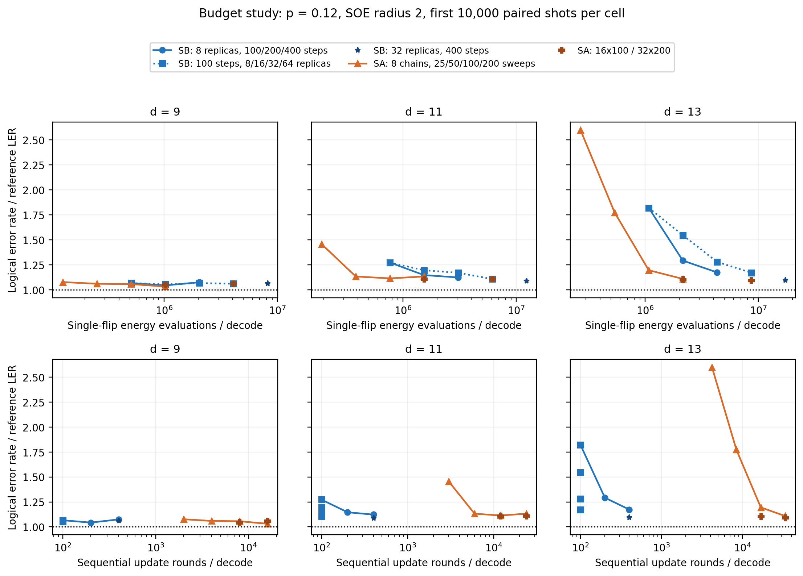
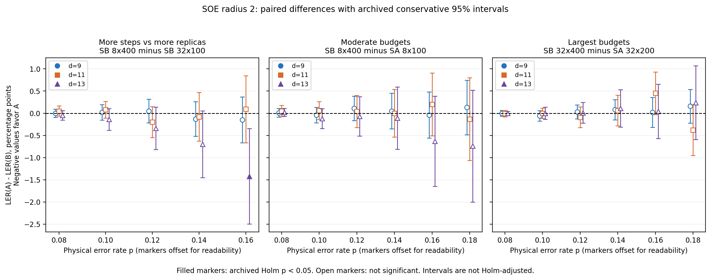

# Supplemental Material: resource, timing, and paired-effect evidence

This material supplements the code-capacity results in the manuscript. The plots reuse the samples described in Sec. III A and therefore do not constitute independent evaluations. The repository-local source index is in [ARCHIVE_DATA_INDEX.md](ARCHIVE_DATA_INDEX.md). A public archive identifier and access URL remain to be supplied before submission.

## S1. Accuracy versus search resources

**Figure S1. Accuracy versus two search resources at \(p=0.12\).** Columns show \(d=9,11,13\). The upper row plots LER/REF against total flip-energy evaluations; the lower row uses sequential update rounds. Horizontal axes are logarithmic. Every point uses SOE radius two and the same 10,000 shots within its cell. Blue circles increase SB steps at eight replicas; blue squares increase replicas at 100 steps; the blue star denotes \(32\times400\). Orange triangles increase SA sweeps at eight chains, and additional SA budgets are marked separately. Both rows use the same accuracy point estimates. Supplemental Fig. S2 gives paired uncertainty for selected comparisons. The horizontal coordinates count search work and sequential rounds under Eq. (10), not measured runtime or complete end-to-end cost. Changing the replica count at a fixed number of SB steps leaves the round count unchanged. Additional noise slices are linked in the Supplemental Material; the \(p=0.18\) slice contains only the configurations evaluated there.

For measured time, see the optimized CP accuracy–time comparison in manuscript Figure 4; the resource counts above exclude complete end-to-end costs.

## S2. Paired effect sizes

**Figure S2. Paired effect sizes for budget comparisons.** The horizontal axis is physical error probability; small marker offsets are for display only. The vertical coordinate is \(100[\mathrm{LER}(A)-\mathrm{LER}(B)]\), in percentage points; negative values favor the first configuration named in each panel. Panels compare SB \(8\times400\) with SB \(32\times100\), SB \(8\times400\) with SA \(8\times100\), and SB \(32\times400\) with SA \(32\times200\). All use radius two. Color and marker shape identify distance. Error bars are conservative per-cell 95% intervals obtained by differencing Bonferroni-allocated Clopper–Pearson intervals for the two discordant-outcome probabilities. They are not Holm-adjusted simultaneous intervals across cells. Filled markers indicate an exact paired test with an archived Holm-adjusted value below 0.05, using the comparison families defined in Sec. III C; the tests are not recalculated for the displayed subset. The intervals and corrected tests are distinct procedures; absence of significance does not establish equivalence. The left panel covers 15 cells at \(p=0.08\)–0.16; the other panels cover 18 cells at \(p=0.08\)–0.18. SB \(32\times100\) was not evaluated at \(p=0.18\).

The intervals and Holm-adjusted tests answer different statistical questions. Neither nonsignificance nor overlapping intervals establish equivalence.

## S3. Additional resource slices

The following five pages contain the [p = 0.08](figures/resources_p0.08.pdf), [0.10](figures/resources_p0.10.pdf), [0.14](figures/resources_p0.14.pdf), [0.16](figures/resources_p0.16.pdf), and [0.18](figures/resources_p0.18.pdf) slices, which use the same resource definitions as Supplemental Fig. S1. The p = 0.18 slice includes only configurations evaluated at that noise rate. These slices provide additional views of the same observations.
